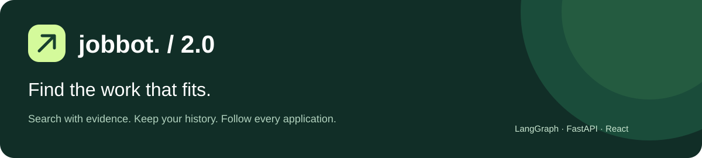
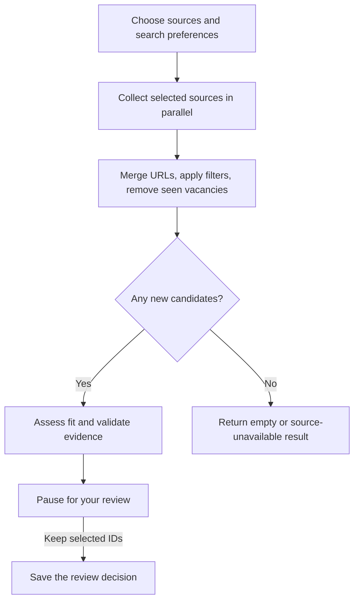

<p align="center"></p>

# JobBot 2.0

**A personal job-search workspace that remembers what you have already seen — and where you have already applied.**

Searching for a job is rarely the hard part. Keeping track of scattered listings, checking whether a role actually fits, and remembering which companies have replied is where the work piles up.

JobBot brings that work into one place. Upload a CV, choose your search preferences, review a shortlist with evidence, and optionally sync application updates from Gmail.

Built with **Python · FastAPI · LangGraph · SQLite · React · TypeScript**. Model calls use an authenticated **Codex CLI**. This is a working local portfolio application, not a hosted multi-user service.

## A calmer way to search

| View | What belongs here |
| --- | --- |
| **Latest results** | New matches from the latest search, with fit scores and source links. |
| **Historical** | Vacancies already shown in earlier searches, ordered by date and relevance. |
| **Applications** | Applications found in email, with confirmations, assessments, interview updates and rejections. |

The interface has light and dark themes, responsive one/two-column cards, selectable sources, pagination and expandable analysis. Email sync has its own panel. A vacancy matched to an application disappears from Latest and Historical.

## What makes this more than a search wrapper

- **The workflow can stop and resume.** LangGraph pauses for a human shortlist decision. SQLite checkpoints preserve that pause across restarts.
- **A fit score has something behind it.** Cards include analysis and short CV/posting quotes. Supported skill coverage stays separate from the model's overall fit score.
- **Partial failure is visible.** One unavailable source does not erase the successful results from other sources.
- **Email becomes a timeline.** A rejection is kept alongside its source email. A later automated receipt cannot quietly turn it back into “Applied”.
- **Uncertainty stays visible.** Missing salary or language requirements are not presented as verified facts.

## How LangGraph fits in



The graph controls orchestration and the review pause. The model supplies structured suggestions and assessments; Python validates their shape and evidence. [See the actual nodes, state and recovery path →](docs/architecture.md)

## Run it

Requires **Python 3.11+** and **Node.js 22.12+**.

```bash
python -m venv .venv
# Activate: .venv/Scripts/Activate.ps1 on PowerShell
# Or: source .venv/bin/activate on macOS/Linux
python -m pip install -e ".[test]"
npm --prefix frontend ci
npm --prefix frontend run build
python -m uvicorn jobbot.api:app --host 127.0.0.1 --port 8000
```

Open **http://127.0.0.1:8000**. Live CV analysis, web search and fit assessment require Codex CLI sign-in. Gmail sync also requires a connected Gmail plugin in that same CLI environment.

Want to inspect the project without connecting accounts? Run the synthetic evaluation:

```bash
python -m jobbot.evaluate
```

For an offline UI walkthrough, follow [the setup guide](docs/running.md#offline-walkthrough). The sample CV and companies are fictional.

## Read the parts that interest you

- [Architecture and LangGraph flows](docs/architecture.md) — two workflows, checkpoints and the application timeline.
- [Running and configuring JobBot](docs/running.md) — live mode, offline mode and useful settings.
- [Data boundaries and limitations](docs/privacy.md) — what stays on disk, what reaches a model, and what a hosted version still needs.

## Verification

```bash
python -m unittest discover -s tests -v
python -m jobbot.evaluate
npm --prefix frontend run build
```

GitHub Actions runs the backend suite, synthetic evaluation and frontend build. Tests cover checkpoint recovery, source failures, evidence validation, application status precedence, mailbox separation and automatic matching across result views. The synthetic evaluation is a small reproducibility fixture, not a claim about real-world ranking accuracy.

## Scope

JobBot helps you decide where to apply. It does not submit applications or send emails. Public sources can block access or change, model output can be wrong, and an English advert alone does not prove an English-speaking team. Open the original posting before acting.

This public snapshot includes source code, tests and fictional examples. It contains no CV uploads, mailbox exports, saved search database or account credentials.
