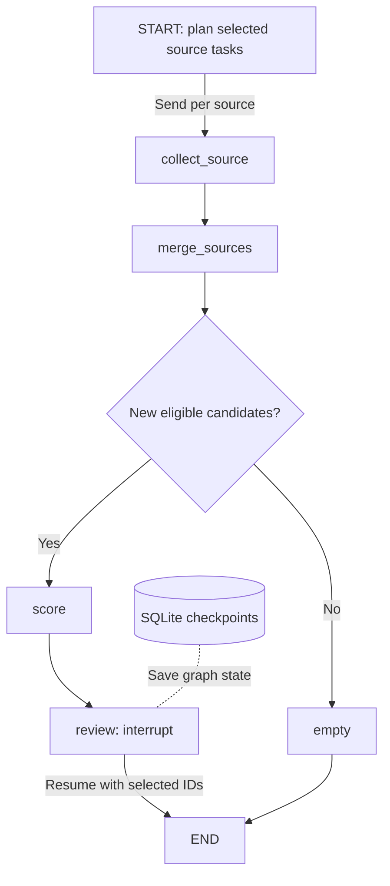
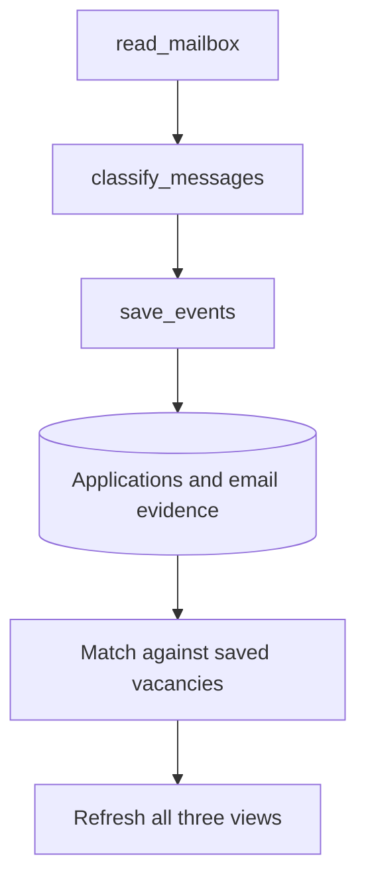
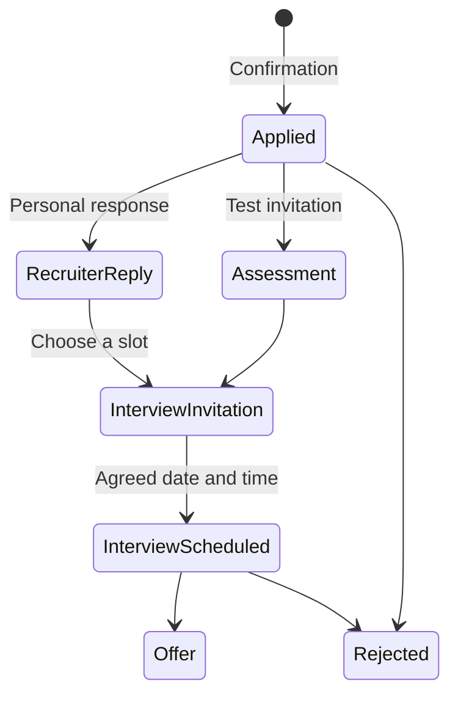

# Two workflows, one workspace

JobBot separates finding opportunities from tracking applications. That keeps an inbox refresh independent of a long search and makes both flows easier to reason about.

## 1. Finding vacancies

The implementation lives in [`jobbot/workflow.py`](../jobbot/workflow.py).

**Fan out, then gather.** `plan` is the conditional route from START, not a separate registered node. It creates a `Send` task for each selected source. `collect_source` returns a batch; the state's list reducer combines those batches. The API config allows up to three concurrent graph tasks.

**Merge before assessing.** `merge_sources` canonicalizes links, merges tracking variants, applies preferences and removes previously seen IDs. An unavailable source is recorded explicitly. If every selected source fails, `empty` reports a different outcome from a successful search with no matches.

**Keep the model focused.** Web discovery receives skills, roles and preferences, not the full CV. Ranking receives the contact-masked CV and posting text. A keyword baseline orders candidates; up to 40 receive an overall model assessment in the current implementation. At most 100 matches enter the displayed shortlist. A card can therefore have skill coverage without an assessed fit score.

**Pause where a person should decide.** `review` calls `interrupt` with the allowed vacancy IDs. The API resumes that run using `Command(resume=...)`. The checkpointer stores the run's thread ID and state, so closing the process does not lose a pending review. Submitted IDs are validated again; repeating the same saved selection is idempotent in this local deployment.

The state carries the CV, preferences, source batches, exclusions, shortlist and reviewed IDs. This is why the checkpoint database must be treated as personal data, not a disposable public log.

## 2. Tracking applications

The implementation lives in [`jobbot/application_sync.py`](../jobbot/application_sync.py).

This is a separate LangGraph. Unlike the search graph, it does not use a graph checkpointer. Its durable progress comes from the application store's processed-message IDs and per-mailbox cursor.

1. **Read.** The Codex Gmail process confirms the account profile, then searches and reads a bounded page. The first sync covers 180 days; later scans overlap seven days. Each page handles up to 25 messages.
2. **Classify.** Structured model output identifies recruitment events. Event IDs must come from the supplied messages, and each supporting quote must occur in the subject or body. Newsletters and cold outreach are excluded by the extraction prompt.
3. **Save.** Only after reading and classification succeed are events, processed IDs and the sync cursor stored in one SQLite transaction. Repeating a page does not duplicate the same message.

Mailbox bodies are temporary model inputs. Stored evidence includes message/thread IDs, subjects, short quotes and timestamps. The Gmail adapter enables only profile/search/read actions for the selected app, and checks successful tool-call events rather than accepting final model prose as proof of a read.

## A timeline, not a single overwritten label

This diagram illustrates common paths; the store can ingest an event even when earlier emails are absent. An invitation to book a slot stays an invitation until a concrete agreed time is stated. All events remain visible. For non-terminal states, progression takes precedence over a late lower-stage receipt. For terminal states, the latest terminal event wins.

## Why the three tabs stay in sync

Saved search checkpoints supply Latest results and Historical. The application store is reconciled against those saved vacancies whenever views load and after new searches. Matching uses a canonical vacancy URL or one unambiguous company/role match, ignoring legal company suffixes and gender markers. Missing role names are not matched by company alone. Ambiguous matches remain unlinked.

That reconciliation also handles an application imported *before* a vacancy is discovered. Matching is deterministic; it does not ask another model to guess which listing to hide.

## A few deliberate boundaries

| Boundary | Reason |
| --- | --- |
| Intake / discovery / ranking use separate calls | The full CV is not needed to discover URLs. |
| Coverage and fit are separate fields | A broad CV should not receive a weak fit merely because a role needs only part of its stack. |
| Original source links and quotes remain visible | The user can check the reasoning. Quote checks establish provenance, not semantic correctness. |
| Sync has its own lock and graph | A failed mailbox read cannot advance the application cursor. |
| SQLite and one local process | Simple to run and inspect; a shared hosted service needs a different isolation and execution model. |
