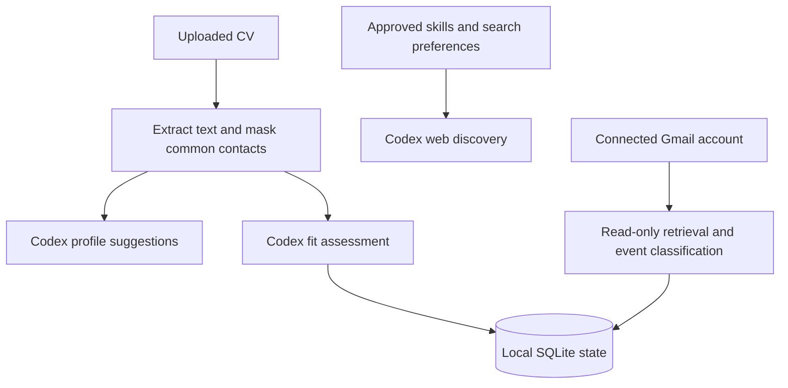

# Where the data goes

The public repository is a clean source snapshot. Running the app creates private local state that must stay outside Git.

| Data | Handling |
| --- | --- |
| CV upload | PDF/text is extracted; extracted text and evidence enter local checkpoints. |
| Profile and ranking | Contact-masked CV text is submitted through Codex. Other identifying details can remain. |
| Web discovery | Receives skills, roles and preferences, not the full CV. |
| Email bodies | Temporary inputs for retrieval and classification; they are not stored as full-message exports. |
| Application history | Stores mailbox address, company/role, state events, message/thread IDs, subjects and short evidence quotes. |
| Credentials | Reuses the operator's Codex/plugin connections; credentials are not part of the repository. |
| Diagnostics | Filtered error details and tool-call metadata; excluded from publication. |
| Theme and selected inbox | Remembered in the browser's local storage. |

Contact masking is not anonymization. Exact-quote validation is not a guarantee that a model understood a requirement correctly. Email content and postings are treated as untrusted input, but a local prototype is not a substitute for security review before hosting.

The `.gitignore` excludes runtime databases, environment files, local environments, uploads/mail exports and logs. These exclusions help avoid accidental commits; they are not a security boundary. Review files before sharing them.

The application never submits job applications or sends mail. It is designed for one trusted operator on localhost. Public access, shared accounts and multi-tenant deployment are outside the current release's scope.
